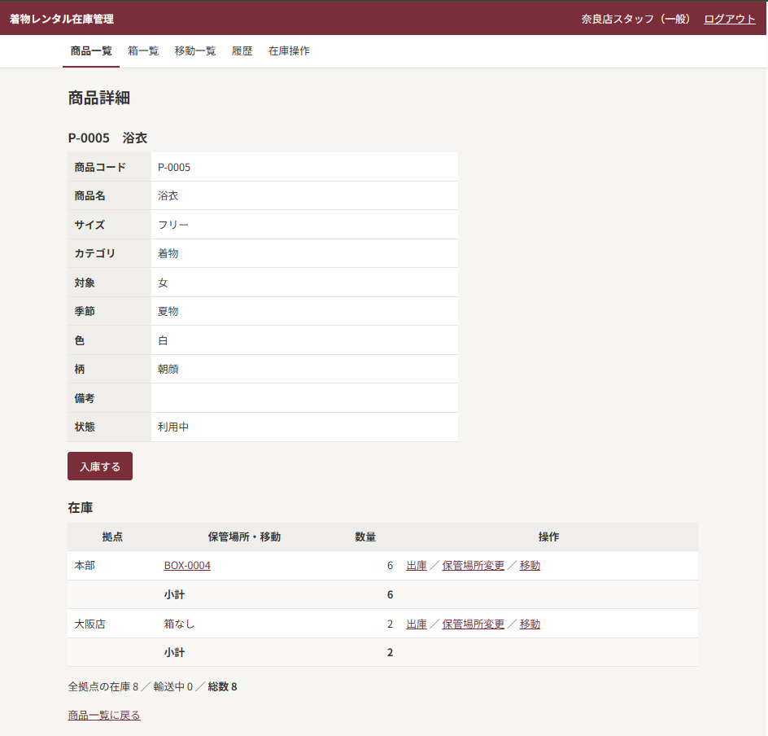
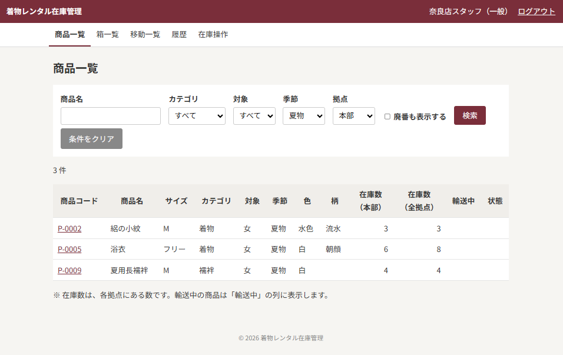

# 着物レンタル在庫管理システム

> 着物レンタル店の商品が「どの拠点の、どの箱に、何個あるか」を、箱を開けずに確認できる在庫管理Webアプリ

> **デモ:** https://kimono-stock.onrender.com（最初の表示に1分ほどかかることがあります／[ログイン用のアカウント](#デモ)）
>
> **技術:** HTML, CSS, JavaScript, PHP 8.3, MariaDB 10.11（フレームワーク不使用）, Docker, Render

> ✅ **MVP 完成・公開中**：要件定義から設計・実装・テスト・公開まで、一人で行いました。今後の改善は [こちら](#今後の改善)。


*本部から奈良店へ商品を発送し、奈良店で受取確認をするまで。受け取るまでは「輸送中」として、どの拠点の在庫にも数えません。*

---

## デモ

**https://kimono-stock.onrender.com**

| アカウント | ログインID | パスワード | できること |
| --- | --- | --- | --- |
| 管理者 | demo_admin | sampleadmin | すべての機能（商品の登録・編集・廃番、拠点管理を含む） |
| 一般（奈良店） | staff1 | samplestaff1 | 在庫の確認・在庫操作・移動の受取確認など |

- 無料のサービスで動かしているため、しばらく使われていないと、**最初の表示に1分ほどかかります**。
- デモのデータは、どなたでも変更できます。データが大きく変わっている場合も、管理者が定期的に初期状態に戻しています。
- サービスが止まっている場合は、上の GIF と、下の機能の説明にあるスクリーンショットをご覧ください。

構成：Render（Docker・PHP 8.3 + Apache）＋ Filess.io（MariaDB 10.11）。詳しくは [公開の手順書](docs/07_deploy.md) を参照してください。

## ひとことで言うと

- **解決したい課題**：  
本部に送ったオフシーズン品が、どの箱に入っているか分からない。Excelの在庫数と実物がずれ、原因も追えない
- **自分の担当**：  
個人開発（要件定義・画面設計・DB設計・実装・テスト・公開まで一人で担当）
- **ここまでの成果**：  
在庫の整合性をDB構造と制約で保証する設計を完成。制約テスト25件で、ルールどおりにデータを拒否・許可することを確認済み

---

## 開発背景

- **きっかけ**：  
以前、着物レンタルの現場で働いていた。店舗に置ききれないオフシーズン品を本部へ送ると、手書きの箱ラベルは表記がバラバラで、箱を開けないと中身が分からなかった
- **既存の解決策の不足**：  
Excelの在庫表は「拠点ごとの数」しか持てず、箱単位の中身や、送った商品が届いたかまでは管理できない。忙しいときの記録漏れで数がずれても、原因を追跡できなかった
- **目指したこと**：  
現地へ行かずに「どこに何があるか」が分かり、数が合わないときは「いつ・誰が・何をしたか」までさかのぼれる状態

---

## 主な機能

### 商品が、どの拠点のどの箱に何個あるかが分かる


### 本部に預けている夏物を、検索で確認できる


- **箱単位の在庫管理**：  箱IDから中身が分かる。箱に入っていない商品も「箱なし」として同じ仕組みで管理
- **在庫検索**：          商品から拠点別・箱別の数量を確認。種類・対象（女・男・子）・季節（夏物・冬物・通年）で絞り込める
- **拠点間の移動**：      商品単位の移動と、箱ごとの移動に対応。発送→受取確認の2段階で記録し、未受取の移動を一覧表示
- **保管場所変更**：     同じ拠点内で、箱と箱、箱と箱なしの間で商品を移す。移動と同時に新しい箱を作成できる
- **操作履歴**：         在庫が変わるすべての操作を、日時・操作者つきで記録

---

## 技術的なこだわり（設計・実装）

### 1. 「1つの事実を1箇所で持つの原則」によるデータ整合性の保証
* **課題**： 「拠点在庫数」と「箱内数量」を別テーブルで管理すると、二重更新による不整合が構造的に発生する。
* **工夫・効果**： 「箱なし」も各拠点の特殊な箱（共通ID）として扱い、全在庫を「**箱 × 商品 × 数量**」の**1テーブルに集約**。拠点在庫数はSQL集計でリアルタイム算出するため、拠点合計と箱内数量の食い違いが仕組み上絶対に起こりません。

### 2. 業務ルールのDB制約化と制約テスト（25パターン）での検証
* **課題**： アプリケーション層（PHP）のロジック抜けによる不正データの混入リスク。
* **工夫・効果**： 「在庫数 ≧ 1」「箱なし箱は拠点に1つのみ・移動不可」といった業務ルールを**CHECK制約・UNIQUE制約**としてDBに実装。わざとルール違反データを挿入する25パターンの制約テストを作成した際、`NOT NULL` の `ENUM` 型は値を省略すると自動で初期値が入る仕様に気づき、カラム型を `VARCHAR ＋ CHECK制約` に見直して堅牢性を高めました。

### 3. トランザクションと条件付きUPDATEによる二重加算防止
* **課題**： 配送受取時のボタン連打や同時操作による在庫数の二重更新。
* **工夫・効果**： 発送時に送り元から在庫を減らし、受取確認時に送り先へ加算する処理を構築。受取処理は **「状態が輸送中の場合のみ更新する」条件付きUPDATE** と **トランザクション処理** で厳格に行うことで、二度押しや並行処理が起きても二重加算されない安全な設計にしました。

---

## 起動方法

```bash
# 1. リポジトリのクローンと移動
git clone [https://github.com/yamamoto-log/stock-management-system.git](https://github.com/yamamoto-log/stock-management-system.git)
cd stock-management-system

# 2. DB・ユーザー・テーブルの作成（init.sqlのパスワードを変更後に実行）
mysql -u root -p < database/init.sql
mysql -u root -p kimono_inventory < database/schema.sql

# 3. 接続設定ファイルの作成と環境設定
cp config/database.example.php config/database.php

# 4. ビルトインサーバーの起動（http://localhost:8000）
php -S localhost:8000 -t public
```

※ Linux で `SQLSTATE[HY000] [2002] No such file or directory` が出る場合は、`config/database.php` の `socket` に MariaDB のソケットの場所を指定してください（`SHOW VARIABLES LIKE 'socket';` で確認できます）。

## 開発状況

- [x] 要件定義
- [x] 画面一覧・画面遷移
- [x] データベース設計
- [x] 開発環境の構築
- [x] 開発の土台づくり（共通レイアウト・共通関数・初期データ）
- [x] 各機能の実装（商品・拠点・入出庫・移動・箱・履歴）
- [x] ログイン・セキュリティ
- [x] テスト・公開

## 今後の改善

MVP では在庫の所在と記録の正しさを優先し、次の改善は公開後に取り組む予定です。

- **在庫の選び方**：出庫などの明細で、「保管場所 / 商品」を1つの選択肢から選ぶ形を、保管場所を選んでから商品を選ぶ形にする（在庫の行が増えても探しやすくするため）
- **商品一覧に自拠点の在庫数**：商品一覧を絞り込まずに、所属拠点の在庫数の列を表示する
- **履歴の絞り込み**：期間・商品・操作者で絞り込めるようにする
- **ログインの試行回数の制限**：総当たり攻撃への対策
- **Laravel への移行**：素の PHP で作った版と比べ、フレームワークが何を肩代わりしているかを確かめる

## 設計資料

- [要件定義書](docs/01_requirements.md)：目的・業務ルール・MVPの範囲・画面一覧
- [ER図](docs/02_er.md)：テーブル構成と、整合性を保つ仕組み
- [テーブル定義](database/schema.sql) ／ [制約テスト](database/test_constraints.sql)
- [テストシナリオ](docs/06_test_scenario.md)：業務の流れに沿ったテストと結果
- [公開の手順書](docs/07_deploy.md)：本番の構成・設定・手順