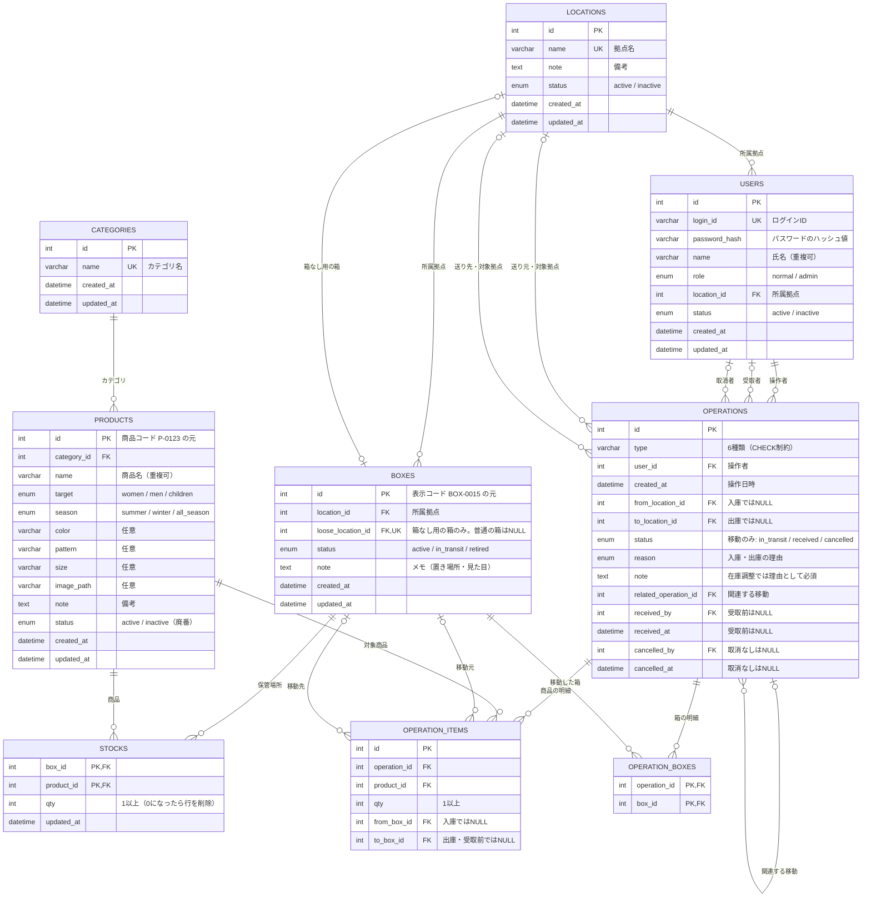

# ER図

着物レンタル店向け在庫管理アプリのテーブル構成です。テーブルの正確な定義は `database/schema.sql` を正とします。

## テーブルの役割

| テーブル | 役割 |
|---|---|
| locations | 拠点（店舗・本部） |
| categories | 商品のカテゴリ |
| users | ユーザー（社員） |
| products | 商品マスタ。サイズ違い・色違いは別商品。種類・対象・季節の3軸で分類 |
| boxes | 箱。各拠点に1つずつ「箱なし用の箱」を含む |
| stocks | 在庫。すべての在庫を「箱 × 商品 × 数量」で持つ唯一のテーブル |
| operations | 在庫操作のヘッダ。入庫・出庫・在庫調整・保管場所変更・商品移動・箱ごと移動を記録し、履歴を兼ねる |
| operation_items | 商品の明細（箱ごと移動以外の操作） |
| operation_boxes | 箱ごと移動で送った箱 |

## 整合性を保つ仕組み

在庫は stocks の1か所でのみ持ち、拠点別の在庫数は集計で求めます。拠点の情報は箱だけが持つため、拠点合計と箱内数量の不一致は構造上起こりません。輸送中の箱（status = in_transit）は、拠点別の集計から除外します。

DBの制約で守っているルールは次のとおりです。

| 制約 | 守っているルール |
|---|---|
| stocks の主キー (box_id, product_id) | 同じ箱に同じ商品の行は1つだけ |
| ck_stocks_qty | 在庫数は1以上（マイナス・0の行を残さない） |
| uk_boxes_loose_location_id | 箱なし用の箱は拠点ごとに1つだけ |
| ck_boxes_loose_location_id | 箱なし用の箱は自拠点にあり、箱ごと移動できない |
| ck_operations_type | 操作の種類は6種類のみ |
| ck_operations_status | 状態を持つのは移動だけ |
| ck_operations_received / ck_operations_cancelled | 受取者と受取日時、取消者と取消日時は必ずセット |
| ck_operation_items_box | 明細には移動元か移動先の少なくとも一方がある |
| ck_operation_items_diff_box | 移動元と移動先は別の保管場所 |
| ck_operation_items_qty | 明細の数量は1以上 |
| すべての外部キー（ON DELETE RESTRICT） | 参照されているデータは削除できない（マスタは論理削除） |

制約が意図どおりに動くことは、`database/test_constraints.sql` で確認しています。

## 設計上の判断

- **operations.type を ENUM にしない理由**：NOT NULL の ENUM は、値を省略すると最初の値が自動で入る。指定し忘れが別の種類の操作として記録されるのを防ぐため、VARCHAR（省略するとエラー）と CHECK 制約で表現している。テストで発見した。
- **受取・取消を発送の行に書き足す理由**：移動の状態を1行で判断でき、二重加算の防止（状態を条件にした更新）と受取待ちの表示がシンプルになる。
- **対象と季節をカテゴリにしない理由**：現場の分類は「種類 × 対象 × 季節」の3軸。組み合わせをカテゴリにすると54通りに増え、1つの軸だけで絞り込めなくなる。季節を商品の項目として持つことで、オフシーズン品の所在確認（例：本部にある夏物はどの箱か）がそのまま検索条件になる。
- **履歴テーブルを持たない理由**：記録対象を在庫に影響する操作に限ったため、operations と明細を日時順に並べれば履歴になる。同じ出来事を2か所に記録しない。