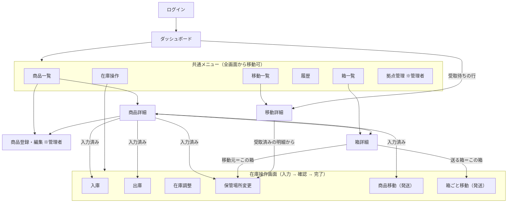

# 画面遷移図

画面一覧と遷移のルールは [要件定義書 7-3](01_requirements.md) を参照。

## 全体の構成

ログイン後は、共通メニューからどの一覧画面にも移動できる。在庫を変更する6つの操作画面は、共通メニューの「在庫操作」から空の状態で開くか、詳細画面のボタンから入力済みの状態で開く。

## 画面内で完結する操作

次の操作は別の画面に移らず、その画面の中で確認して完了する。

| 画面 | 操作 |
| --- | --- |
| 箱詳細 | メモの編集、廃止（空の箱のみ） |
| 移動詳細 | 受取確認、取消（受取前のみ） |
| 商品詳細 | 廃番（管理者のみ） |
| 拠点管理 | 登録・編集・停止・再開 |

## 完了後の戻り先

操作画面の完了後は、操作を始めた画面に戻る。共通メニューから開いた場合は、操作の結果が分かる画面（例：入庫なら商品詳細、保管場所変更なら移動先の箱詳細）に移動する。
