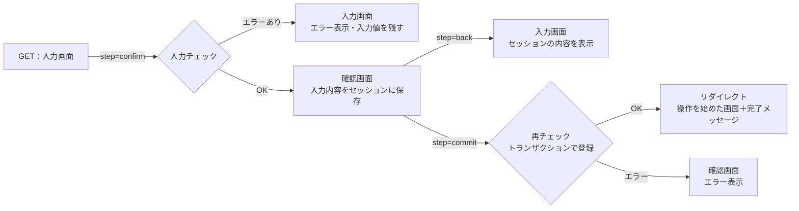

# 画面の共通ルール

登録・編集・在庫操作の画面は、すべてこのルールと型で作る。

## 1. 入力 → 確認 → 完了の流れ

**1つの操作を1つのPHPファイルで作り、送信ボタンの `step` の値で処理を切り替える。**



| step | 処理 |
| --- | --- |
| （なし・GET） | 入力画面を表示する。詳細画面から来た場合は、URLの値を初期値として入れる |
| confirm | 入力チェックをする。エラーがあれば入力画面に戻す。なければ入力内容をセッションに保存し、確認画面を表示する |
| back | セッションの内容を入れた入力画面を表示する（入力し直し） |
| commit | CSRFトークンを確認し、**セッションの内容**を使って登録する。完了したらセッションを消し、完了メッセージを設定してリダイレクトする |

### 決めたルール

- **完了画面は作らない。** 登録後は、操作を始めた画面（共通メニューから開いた場合は結果が分かる画面）へリダイレクトし、フラッシュメッセージで「登録しました」と表示する。
- **リダイレクトしてから表示する（PRGパターン）。** 登録の直後に画面を表示すると、ブラウザの再読み込みで同じ登録がもう一度送信される。リダイレクトすれば、再読み込みしても表示が繰り返されるだけになる。
- **登録にはセッションの内容を使う。** 確認画面に hidden で値を埋め込んで送り直す方法だと、利用者が確認後に値を書き換えられる。確認済みの内容はセッションに置き、commit ではそれを使う。
- **登録の直前にもう一度チェックする。** 確認画面を見ている間に、別の人が同じ在庫を出庫しているかもしれない。在庫数などDBの状態に関わるチェックは、commit のトランザクションの中で必ずやり直す。
- **セッションには操作ごとの名前で保存する。** `$_SESSION['forms']['stock_in']` のように、操作ごとに分ける。同じ操作を2つのタブで同時に開いた場合は後の内容で上書きされるが、MVPでは許容する。

## 2. 入力値のチェック

- **チェックは必ずサーバー側（PHP）で行う。** HTMLの `required` や `type="number"` は入力の補助で、ブラウザの開発者ツールで簡単に外せるため、チェックの代わりにはならない。
- **エラーは、項目名をキーにした配列で集める。** すべての項目を確認してからまとめて表示し、1つ目のエラーで止めない。
- **入力値は残す。** エラーで入力画面に戻したとき、正しく入力された項目は消さない。

### エラーメッセージの書き方

| 場面 | メッセージ |
| --- | --- |
| 必須項目が空 | 〇〇を入力してください。／〇〇を選択してください。 |
| 数量が1未満・数字でない | 数量は1以上の整数で入力してください。 |
| 文字数が多すぎる | 〇〇は△文字以内で入力してください。 |
| 選択肢にない値 | 〇〇の選択が正しくありません。 |
| 在庫が足りない | 〇〇の在庫が足りません（残り△）。 |
| 重複 | 同じ〇〇がすでに登録されています。 |

## 3. エラーの表示

- 画面上部に「入力内容に誤りがあります。」とまとめて表示する。
- 各項目の下に、その項目のエラーを赤字で表示する（CSS：`.field-error`）。

## 4. 予期しないエラー

- 登録処理は `try` で囲み、失敗したらトランザクションを取り消す（rollBack）。
- 開発中（debug = true）はエラーの詳細を表示する。本番（debug = false）では「エラーが発生しました。時間をおいて、もう一度操作してください。」とだけ表示し、詳細はログに残す。

## 5. 日時

- 日時はすべて MariaDB の `NOW()` で記録する。PHP の `date()` で作った日時は保存しない（PHPとDBの時計がずれても、記録の前後関係が崩れないようにするため）。

## 6. 表の表示

- 見出しは中央揃え、数は右揃え（class="num"）、文字は左揃えにする。
- 数の見出しが長くなる場合は、括弧の前で改行する（例：在庫数<br>（全拠点））。

## コードの型

```php
<?php
require_once __DIR__ . '/../../includes/bootstrap.php';
require_login();

$formKey = 'sample';           // セッションに保存するときの名前（操作ごとに変える）
$step    = $_POST['step'] ?? '';
$errors  = [];
$input   = [];                 // 画面に表示する入力値
$showConfirm = false;

if ($_SERVER['REQUEST_METHOD'] === 'POST') {
    verify_csrf();

    if ($step === 'confirm') {
        $input  = ['name' => trim($_POST['name'] ?? '')];
        $errors = validate_sample($input);
        if (empty($errors)) {
            form_save($formKey, $input);
            $showConfirm = true;
        }

    } elseif ($step === 'back') {
        $input = form_load($formKey) ?? [];

    } elseif ($step === 'commit') {
        $input = form_load($formKey);
        if ($input === null) {
            redirect($_SERVER['PHP_SELF']);   // セッション切れなどで内容がない
        }
        $pdo = getDb();
        try {
            $pdo->beginTransaction();
            // ここで DB の状態に関わるチェックをやり直し、登録する
            $pdo->commit();
        } catch (Throwable $e) {
            $pdo->rollBack();
            throw $e;                          // bootstrap.php の共通処理に任せる
        }
        form_clear($formKey);
        set_flash('success', '登録しました。');
        redirect('/dashboard.php');            // 操作を始めた画面へ
    }
}

$pageTitle = 'サンプル';
require __DIR__ . '/../../includes/layout/header.php';

if ($showConfirm) {
    // 確認画面：入力内容を表示し、「戻る」と「登録する」のボタン
    // <button name="step" value="back"> と <button name="step" value="commit">
} else {
    // 入力画面：エラーと入力値を表示し、「確認する」のボタン
    // <button name="step" value="confirm">
}

require __DIR__ . '/../../includes/layout/footer.php';
```
