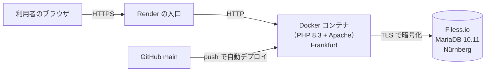

# 公開の手順書

本番環境の構成と、公開・更新・データの戻し方をまとめる。

## 1. 構成



| 役割 | サービス | プラン |
| --- | --- | --- |
| アプリ | Render（Web Service、Docker） | Free |
| DB | Filess.io（MariaDB 10.11） | Free |
| ソースコード | GitHub | — |

## 2. この構成にした理由

### DB の選定

このアプリは、データの整合性の多くを DB の CHECK 制約・外部キーで守っている。そのため、本番の DB を選ぶときは、**database/test_constraints.sql を流して、すべて期待どおりになるか**を判定の基準にした。

| 候補 | 結果 |
| --- | --- |
| TiDB Cloud Starter | CHECK 制約が効かないため不採用 |
| Aiven for MySQL（無料枠） | 2026年11月6日で新規作成が終了しており、利用できなかった |
| **Filess.io（MariaDB 10.11）** | test_constraints.sql がすべて期待どおり。strict モードも有効。採用 |

### アプリの置き場所

- Docker を経験するため、PHP を Docker で動かす Render を選んだ
- GitHub の main に push すると自動で公開されるようにした
- 地域は、DB（ドイツ・ニュルンベルク）に近い Frankfurt にした（SQL 1回ごとの待ち時間を短くするため）

## 3. 設定の分け方

開発と本番で、設定の置き場所を分けている。本番の秘密の情報（DB のパスワードなど）は、コードにもファイルにも書かず、Render の環境変数で渡す。

| 設定 | 開発（手元の PC） | 本番（Render） |
| --- | --- | --- |
| DB の接続情報 | config/database.php（Git で管理しない） | 環境変数 |
| debug | 起動するときに `APP_DEBUG=true` を付ける | 指定しない（＝ false） |
| DB との通信の暗号化 | しない（同じ PC の中で完結するため） | **必ずする**（環境変数で接続するときは自動） |
| ユーザーのパスワード | database/dev_users.sql（Git で管理しない） | database/prod_users.sql（Git で管理しない） |

### 本番の環境変数

| Key | 内容 |
| --- | --- |
| DB_HOST | Filess.io のホスト名 |
| DB_PORT | Filess.io のポート番号 |
| DB_NAME | Filess.io の DB 名 |
| DB_USER | Filess.io のユーザー名 |
| DB_PASSWORD | Filess.io のパスワード |
| TRUST_PROXY | `true`（Render の入口が HTTPS だったことを、X-Forwarded-Proto ヘッダーで判断するため） |

入れないもの：

- APP_DEBUG：入れなければ false になる。本番ではエラーの詳細を画面に出さない
- DB_SSL_CA：入れなくても、標準の証明書（/etc/ssl/certs/ca-certificates.crt）で必ず暗号化される

## 4. セキュリティで判断したこと

| 項目 | 判断 |
| --- | --- |
| debug の初期値 | 指定がなければ false。本番で設定し忘れても、エラーの詳細が出ない |
| DB との通信 | Filess.io は暗号化なしの接続も受け付けるため、DB 側では強制できない。アプリ側（includes/db.php）で、本番では必ず証明書を指定して接続する。証明書で、接続先が本物かも確かめる |
| HTTPS の判定 | Render では、コンテナの Apache には HTTP で届く。X-Forwarded-Proto を見て HTTPS と判断し、Cookie に Secure を付ける。ただし、このヘッダーは誰でも付けられるので、TRUST_PROXY=true のときだけ信じる |
| 公開フォルダ | Apache のドキュメントルートを public/ にした。config/ や includes/ は URL で開けない |
| コンテナに入れないもの | .dockerignore で、.git・config/database.php・database/・notes/ を除いた |
| 本番のパスワード | 開発用とは別のものでハッシュ値を作った。開発用のハッシュ値は過去に GitHub にコミットしてしまったため、本番では使えないことを確認した |
| デモ用のアカウント | 公開する管理者（demo_admin）と、非公開の管理者（admin）を分けた |

## 5. 初めて公開するときの手順

### 5-1. Filess.io で DB を作る

1. Filess.io で、無料プランの MariaDB の DB を作る
2. 手元の PC から接続する（プロジェクトのフォルダで実行する）

```
mariadb -h ホスト名 -P ポート番号 -u ユーザー名 -p --ssl --ssl-verify-server-cert DB名
```

3. 版と制約を確かめる

```sql
SELECT VERSION();                          -- 10.2.1 以上であること
source database/schema.sql
source database/test_constraints.sql       -- すべて期待どおりであること
```

### 5-2. 本番のユーザーのパスワードを作る

パスワードをターミナルの履歴に残さないよう、`read -rs` で入力してからハッシュ値を作る。アカウントごとに1行ずつ実行する。

```
read -rs NEWPASS
echo ${#NEWPASS}
NEWPASS="$NEWPASS" php -r 'echo password_hash(getenv("NEWPASS"), PASSWORD_DEFAULT), PHP_EOL;'
unset NEWPASS
```

作ったハッシュ値を database/prod_users.sql に書く（.gitignore に登録済み）。

```sql
UPDATE users SET password_hash = 'adminのハッシュ値'  WHERE login_id = 'admin';
UPDATE users SET password_hash = 'staff1のハッシュ値' WHERE login_id = 'staff1';
INSERT INTO users (login_id, password_hash, name, role, location_id)
VALUES ('demo_admin', 'demo_adminのハッシュ値', 'デモ管理者', 'admin', 1);
```

### 5-3. DB にデータを入れる

```sql
source database/schema.sql
source database/seed.sql
source database/prod_users.sql
source database/sample_data.sql
```

### 5-4. 手元で Docker を試す（任意）

```
sudo docker build -t kimono-app .

read -rs DB_PASSWORD
export DB_PASSWORD
export DB_HOST=ホスト名 DB_PORT=ポート番号 DB_NAME=DB名 DB_USER=ユーザー名

sudo -E docker run --rm -p 8080:10000 \
  -e DB_HOST -e DB_PORT -e DB_NAME -e DB_USER -e DB_PASSWORD \
  kimono-app
```

`http://localhost:8080` でログインできれば、Render に置くものと同じ箱が動いている。

暗号化されているかは、次で確かめる（`Value` に TLS_… が出れば暗号化されている）。

```
sudo -E docker run --rm \
  -e DB_HOST -e DB_PORT -e DB_NAME -e DB_USER -e DB_PASSWORD \
  kimono-app \
  php -r 'require "/var/www/html/includes/db.php"; var_dump(getDb()->query("SHOW SESSION STATUS LIKE \"Ssl_cipher\"")->fetch());'
```

注意：

- `sudo` は環境変数を引き継がないので、`sudo -E` にする
- コードを直したら、`docker build` をし直さないとコンテナに反映されない
- 学校の PC（WSL）では、先に `sudo service docker start` で Docker を起動する

### 5-5. Render で公開する

1. Render に GitHub のアカウントで登録する
2. New → Web Service で、このリポジトリを選ぶ
3. 次のとおり設定する

| 項目 | 値 |
| --- | --- |
| Region | Frankfurt (EU Central)（**作った後は変えられない**） |
| Branch | main |
| Runtime | Docker |
| Instance Type | Free |

4. サービスを開き、左のメニューの Environment で、環境変数を6つ入れて「Save and deploy」
5. Events で「Deploy live」になったら、URL を開く

## 6. 公開した後に確かめること

| 確かめること | 期待する結果 |
| --- | --- |
| URL を開く | HTTPS でログイン画面が出る |
| admin・demo_admin・staff1 でログイン | ログインできる |
| 開発用のパスワードでログイン | ログインできない |
| `/config/app.php` を開く | Not Found |
| Cookie（PHPSESSID） | Secure・HttpOnly に ✓、SameSite が Lax |
| テストシナリオの主な流れの後、check_consistency.sql | 0行 |
| 実物のスマートフォン | ログイン・出庫（数字のキーボード）・受取確認ができる |

## 7. 更新するとき

| 変更 | すること |
| --- | --- |
| コード | main にマージ（push）するだけ。Render が自動で build して入れ替える |
| 環境変数 | Render の Environment で変えて「Save and deploy」。「Save only」にした場合は、Manual Deploy → Deploy latest commit |
| DB の構造（テーブル・列・制約） | Filess.io に接続して ALTER を実行する。schema.sql も同じ内容に直す |

## 8. デモのデータを元に戻すとき

Filess.io に接続して、作り直す。

```sql
source database/schema.sql
source database/seed.sql
source database/prod_users.sql
source database/sample_data.sql
```

作り直した直後のダッシュボードは、本部 22・奈良 16・大阪 7・輸送中 0・合計 45 になる。

## 9. 無料プランの制限

| 制限 | 影響 |
| --- | --- |
| Render：15分使われないと眠る | 最初の表示に1分ほどかかる。README に書いておく |
| Render：無料のサービス全体で月750時間 | サービスは1つだけにする |
| Render：ファイルは再起動で消える | ログイン（セッション）が切れる。デモとしては許容する |
| Filess.io：容量 10MB | サンプルデータで約 0.45MB。十分に余裕がある |
| Filess.io：同時接続数が少ない | 同時に多くの人が開くと、接続できないことがある |
| 無料プランの条件は変わることがある | README に GIF を載せ、デモが止まっていても内容が伝わるようにする |

## 10. つまずいたことと対処

| 症状 | 原因 | 対処 |
| --- | --- | --- |
| `source` で `error: 2` | MariaDB を起動したフォルダから見て、ファイルが見つからない | プロジェクトのフォルダで接続し直す |
| `Access denied … (using password: NO)` | パスワードが渡っていない（`read -s` にコマンドを貼り付けた、Render の DB_PASSWORD が空） | 1行ずつ実行する。Render の環境変数を確かめる |
| `Access denied … (using password: YES)` | パスワードの値が違う | `read -rs` で入れ直す（`-r` がないと `\` が消える） |
| `Ssl_cipher` が空 | 暗号化されていない。古いイメージを使っていた | `docker build` をし直す |
| docker run で環境変数が渡らない | `sudo` が環境変数を引き継がない | `sudo -E` |
| `unknown flag` | オプションの打ち間違い（`--rum`） | `--rm` |